# multishoot

[](https://github.com/nmoinvaz/multishoot/actions/workflows/build.yml)
[](https://github.com/nmoinvaz/multishoot/actions/workflows/lint.yml)
[](https://codecov.io/gh/nmoinvaz/multishoot)
[](https://crates.io/crates/multishoot)
[](https://docs.rs/multishoot)

Multiple-shooting boundary-value solver for Rust in double-double, quad-double and octo-double precision, with
**bitwise the same results on every SIMD backend**. Taylor series carry the solution across each segment, forward-mode
duals give the exact Jacobian and J v, and [multisolver](https://github.com/nmoinvaz/multisolver) solves for the
unknowns at the nodes.

The equations are written once over a lane type of [multidouble](https://github.com/nmoinvaz/multidouble) and run on
values (the residual), dual numbers (the Jacobian and J v), power series (the residual's series in a parameter) and
complex tangents (the mode matrix).

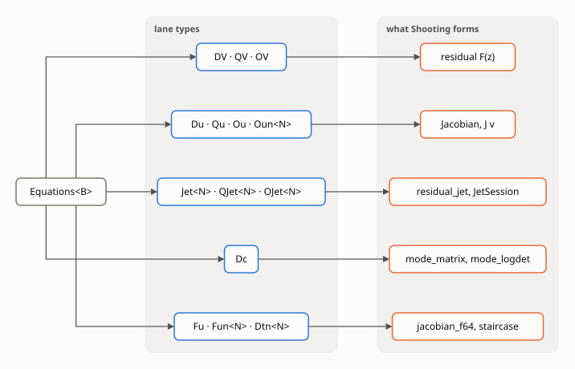

## API

The crate root re-exports the engine's types, multidouble's arithmetic and precisions (`DD`, `Fl`, `cs`, `horner`,
`Precision`, `Double`, `Quad`, `Octo`, ...), multisolver's `Problem`, `Jvp` and `ResidualJet`, and both crates whole.

A state z in the precision P is `P::PARTS` arrays of f64 (2, 4 or 8), part q of unknown i at `z[q][i]`.
multisolver's `prec::parts`, `prec::widen` and `prec::max_abs` borrow its slices, widen it to more parts and give a
residual's max |F|.

### Equations

| Item | What it does |
|---|---|
| `Equations<B>` | the problem's sizes, the Taylor recursion of its right-hand side, and the maps from endpoint data to the end nodes' states |
| `Equations::taylor_coeffs` | Taylor coefficients 1..=kt of every field about x0, from order 0 |
| `Equations::left_state`, `right_state` | the state at the first or last node: boundary conditions at a regular end, a series summed to the node at a singular one |
| `Equations::prepare`, `try_prepare` | what the endpoint maps need once per evaluation, such as a series' coefficient table; errors return through `try_prepare` |
| `Equations::prepare_rate`, `try_prepare_rate` | the same for a mode-matrix evaluation |
| `Equations::taylor_coeffs_at`, `left_state_at`, `right_state_at` | the same maps for order k in the parameter, from the orders kept; by default they form every order |
| `State<T, B>` | the `NF` fields at a point, `Vec<Fl<T, B>>` |
| `Work<T, B>` | one step's coefficients `c[f][k]`, the scratch series `aux`, the order `kt` and a mode-matrix evaluation's rate |
| `lane::Lane` | the lanes the equations are generic over: values (`DV`, `QV`, `OV`), one tangent (`Du`, `Qu`, `Ou`), a complex tangent (`Dc`), series (`Jet<N>`, `QJet<N>`, `OJet<N>`) and f64 tangents (`Fu`, `Fun<N>`, `Dtn<N>`) |

Each of the `NF` fields is held on M = 8 B collocation points of a periodic variable θ (`Fl<T, B>`). `NL` and `NR`
fields of data start the solution at the left and right ends, `NG` globals (an eigenvalue, a period) enter every block,
and `NAUX` scratch series serve the recursion.

`POINTWISE` says that every method acts on each point alone, as in a problem without a periodic direction whose
lanes hold 8 independent problems; one dual evaluation then gives a field's columns at all M points.
`ORDER_BY_ORDER` marks order-k methods that form one order from the kept ones, so a series of order N costs about N
orders, not N evaluations.

Constants enter in double-double (`Fl::cst`, `Fl::muls`). The parameter of the residual's series enters by
`lane::Param::var`: c on value and dual lanes, c + h on a jet.

### Taylor steps

| Item | What it does |
|---|---|
| `Plan` | the Taylor order `kt`, the tolerance `tol` on the last two terms, the largest step `hmax` |
| `taylor::taylor_step`, `taylor_path` | one Taylor step summed by Horner's rule, and a path of steps through given points |
| `taylor::plan_path` | step points between two ends, each step the largest whose terms of orders kt - 1 and kt stay below `tol` |
| `taylor::step_size`, `kth_root` | that step from one step's coefficients, by a k-th root of IEEE operations alone, the same bits on every platform |
| `Plan::optimal_kt`, `candidate_orders`, `taylor::step_cost` | the order of least cost at `tol` under the step cost k^2 + 20 k, and the orders around it to plan |

A step between f64 points is exact in double-double. A step that would leave less than 40% of the rest becomes half
the rest, so a segment ends in two near-equal steps. `plan_path` panics on a coefficient that is not finite and on a
step that does not move x.

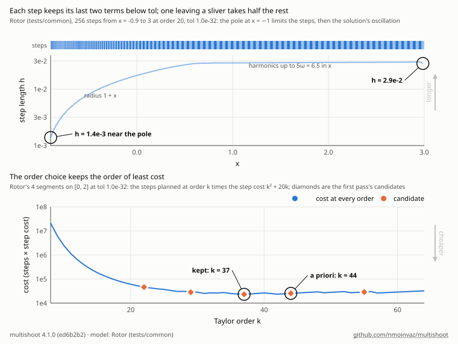

### The layout

| Item | What it does |
|---|---|
| `Shooting<E, B>` | the equations, the nodes, each segment's step points, the extra rows, the row factors and the projected rows |
| `Shooting::new`, `plan_segments` | a layout on increasing nodes, and every segment's steps planned from a state z, on rayon tasks |
| `Shooting::plan_segments_auto`, `OrderChoice` | the segments planned at each candidate order, keeping the cheapest by step counts; `OrderChoice::refined_orders` gives a second pass |
| `ExtraRow` | a linear condition `sum_i w_i z_i - rhs = 0`: a phase condition, a normalization, a pinned unknown |
| `Shooting::off_node`, `off_right`, `off_global`, `row_block`, `row_extra` | the offsets of the unknowns and of the residual's rows |
| `Shooting::block_inputs`, `block_target`, `block_state` | what block b reads, the node it is matched to, and the state it produces |
| `Shooting::match_node`, `row_scale` | the last segment that runs outward (the later ones run inward), and a factor per residual row |

With K nodes the unknowns are

```text
z = [ left data (NL M) | node 0 (NF M) | ... | node K-1 (NF M) | right data (NR M) | globals (NG) ]
```

and the residual has K + 1 blocks of NF M rows, then the extra rows. Block 0 is the left end's state minus node 0,
block b is segment b's Taylor path minus its target node, and block K is the right end's state minus node K-1. The
system is square when NL + NR = NF with one extra row per global.

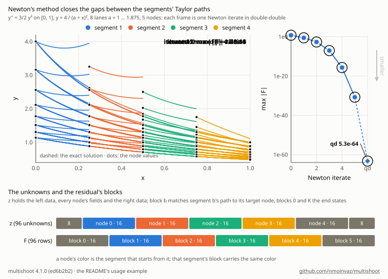

### Residual and derivatives

| Item | What it does |
|---|---|
| `Shooting::residual::<P>` | F(z) in the precision P, each block on its own rayon task under `par` |
| `Shooting::jacobian::<P>` | the exact Jacobian dF/dz by forward-mode duals over the residual's code, as column-major part arrays |
| `Shooting::jacobian_tangents::<P, T>` | `jacobian`, bit for bit, from lanes with N tangents (multidouble's `Oun<N>`): one block evaluation for up to N columns |
| `Shooting::with_tangents` | the layout as an octo-double `Problem` (`WithTangents`) whose Jacobian is `jacobian_tangents` at 1, 2, 4 or 8 tangents |
| `Shooting::jacobian_sub::<P>`, `residual_sub::<P>` | `J[rows, cols]` and `F[rows]`, bit for bit, from only the evaluations that reach them |
| `Shooting::jvp::<P>` | J v and F together, one dual pass per block, without the Jacobian |
| `Shooting::taylor_check::<P>` | each block's truncation error, estimated from the residual with every step halved |
| `Shooting::newton::<P>`, `newton_step::<P>` | multisolver's damped Newton method and its step on this layout |

The Jacobian takes one block evaluation per column, or per input field for a pointwise problem. J v costs K + 1
evaluations, so a Krylov solver needs no matrix.

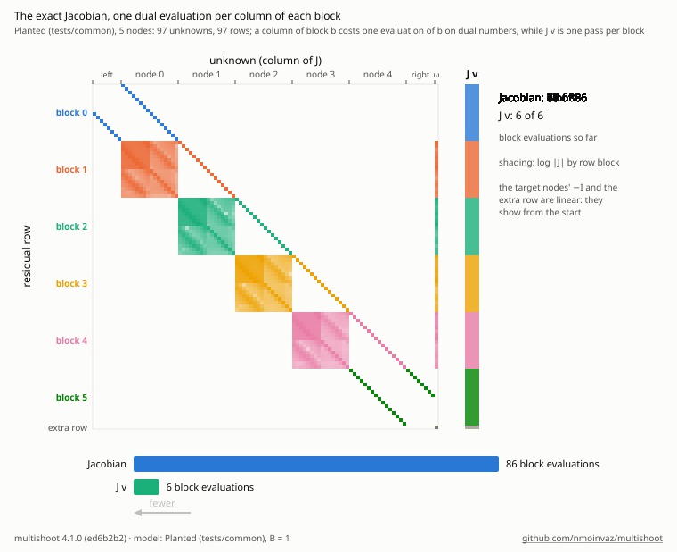

### Series in a parameter

| Item | What it does |
|---|---|
| `Shooting::residual_jet::<P, N>` | the residual's coefficients in the equations' parameter on the jet state `sum_k z_k h^k`, on jets of N coefficients |
| `Shooting::jet_session::<P, N>`, `jet::JetSession` | the same series one order at a time: `next` takes z_k and returns order k + 1 with z_(k+1) zero, and `order` reads an order formed |
| `JetSession::tangent_from` | from a given order on, each order moved by its tangent once z_k is given, equal to `residual_jet`'s to rounding |

Order 0 is the residual; with z_1 given, order 1 is J z_1 + dF/dparameter. A session keeps each block's state, its
endpoint series and each step's work between orders. With the order-k methods an order costs about one evaluation at
one coefficient; with their defaults a session gives `residual_jet`'s bits at its cost.

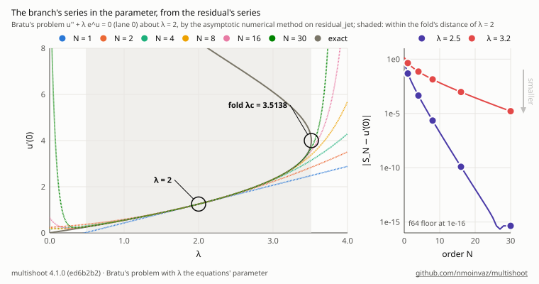

### Mode matrix

| Item | What it does |
|---|---|
| `Rate` | the complex growth rate λ of a mode-matrix evaluation, zero otherwise; `Rate::shift` marks a t-derivative |
| `ModeMatrix` | M(λ), the linearization for perturbations growing as exp(λt), in complex double-double; `logdet` gives ln\|det M\| and arg det M |
| `Shooting::mode_matrix`, `mode_logdet` | M(λ) at a background z from complex tangents (`Dc`), the globals and extra rows held fixed, and its log-determinant |
| `Shooting::mode_matrix_real::<P>` | M(λ) at a real λ in any precision, from P's real tangents (`Du`, `Qu`, `Ou`), as column-major part arrays; at `Double` it is `mode_matrix`'s real part, bit for bit |
| `Shooting::mode_logdets` | `mode_logdet` at many rates on rayon tasks, each value that rate's bits |
| `Shooting::mode_winding`, `mode_zero` | the winding number of det M(λ) along a polygon (the modes inside, less any poles), and one mode's rate by Muller's method |

At λ = 0, M is the Jacobian's leading block. det M(λ) vanishes at each mode exp(λt) g of the linearized problem, so
its winding number along a closed contour counts the modes inside, when det M has no poles there.

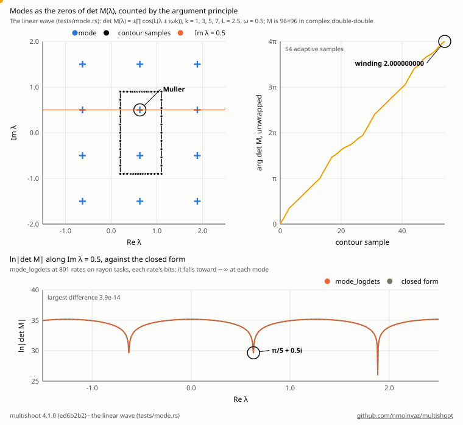

### Periodic direction and relayout

| Item | What it does |
|---|---|
| `periodic::Parity` | a field's symmetry under θ → θ + π: odd or even harmonics on the half grid, or all of them on the full grid |
| `periodic::dmat` | d/dθ on the M points of a grid, exact for harmonics below its Nyquist |
| `periodic::dmat_c`, `dmat_od`, `DMatC` | d/dθ with the f64 remainder of each double-double entry, applied by the quad- and octo-double lanes (about 2⁻¹⁵⁹ per entry), and its entries in octo-double |
| `periodic::theta`, `sin_cos`, `sin_cos_grid`, `sin_cos_pi`, `sin_cos_pi_od` | the grid points, and sines and cosines in double-double, those of rational multiples of π also in octo-double |
| `periodic::spectrum`, `tail`, `Resampler` | a field's Fourier coefficients, its resolution, and its interpolant on another number of points |
| `ProjectedRows`, `Shooting::project_rows` | one field's rows of a block replaced by Π (state - target) + Π' y: its high harmonics unmatched and those of the pinned unknowns y held at zero |
| `Parities` | each field's parity at the left end, at the nodes and at the right end |
| `Shooting::renode`, `resample` | a solution moved to new node positions or to another number of collocation points, to start a Newton solve there |
| `Shooting::split_segments::<P>` | segments of more than `max_steps` steps cut at their step points into blocks of their own, to balance the threads; the residual keeps its rows bit for bit |

The projector Π onto the low harmonics is formed in octo-double from cosines of exact multiples of π, and each
precision reads its leading parts, so the projected rows are exact to the precision of the solve.

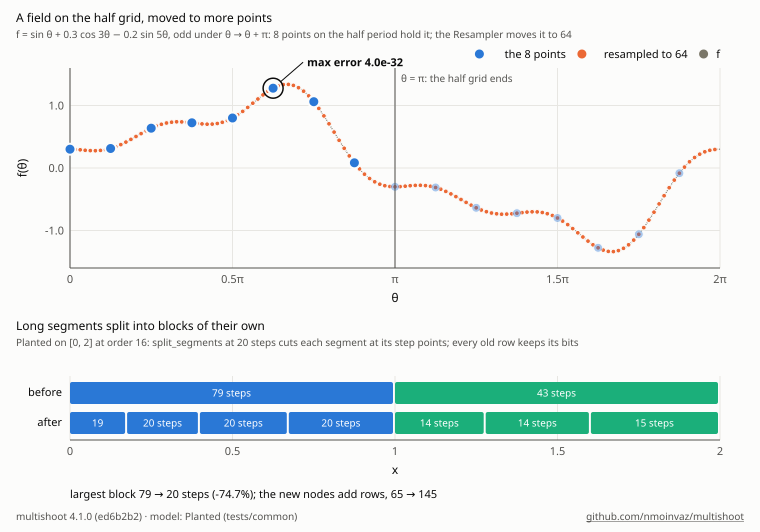

### Fast path

| Item | What it does |
|---|---|
| `Shooting::jacobian_f64::<T>` | the Jacobian in f64 from lanes with f64 tangents (`Fu`, `Fun<N>`, `Dtn<N>`), several columns per evaluation |
| `Shooting::jacobian_staircase::<T>` | the same Jacobian built block by block and factored in staircase storage (multidouble's `StaircaseLu`), never dense |
| `Storage`, `MixedLu` | dense or staircase storage, and the f64 factors, which solve in double-double |
| `Shooting::newton_mixed::<P, T>`, `newton_step_mixed`, `mixed_lu` | Newton's method with the residual in P and the f64 Jacobian as its matrix |
| `Shooting::newton_quasi_mixed::<P, T>` | the same with Broyden's updates (multisolver's QNERR) between its factorizations, so that most steps cost a residual and a solve, and no Jacobian |

The mixed Newton method converges linearly to `newton`'s root, each step contracting by about the f64 Jacobian's
relative error times the conditioning. Staircase storage needs one global and one extra row, with terms on the left
data, the global and node 0.

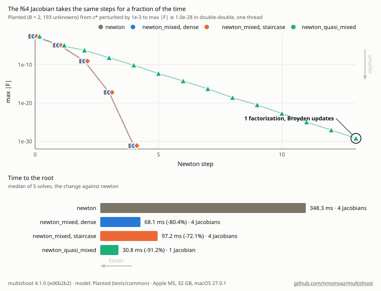

### Solvers

`Shooting` implements three traits of multisolver, and its family view a fourth, whose solvers run on any problem
that does:

| Trait | What it gives | Used by |
|---|---|---|
| `Problem<P>` | `len`, `residual` and `jacobian` | Newton, chord, quasi-Newton (QNERR), Levenberg-Marquardt, Newton with weak directions removed, deflation of known roots |
| `Jvp<P>` | `jvp`, J v without the Jacobian | the Krylov-refined Newton method |
| `ResidualJet<P>` | `residual_jet` on jets of 8, 16 or 32 coefficients, and `jet_orders`: a `JetSession` when `ORDER_BY_ORDER` is set, else multisolver's `Recompute` | the asymptotic numerical method, the exact tangent predictor |
| `Family<P>` | `residual_at`, `jacobian_at` and `dp_at` at any parameter, through `Shooting::in_global` (`InGlobal`) | pseudo-arclength continuation through folds, the fold's location |

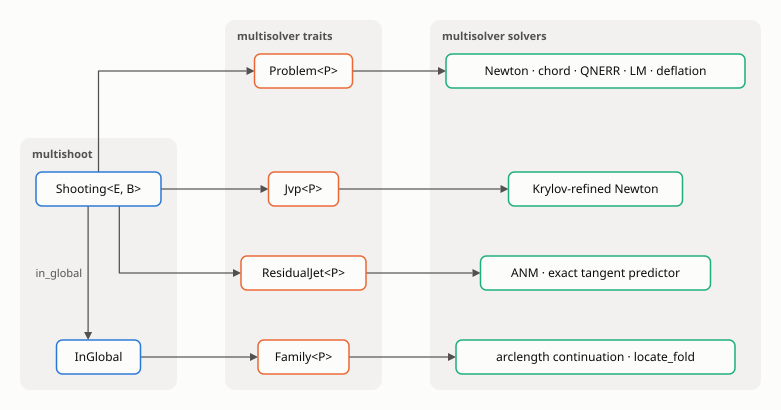

`Shooting::in_global(g, pin)` takes global g as the parameter p and drops the extra row `pin` that fixes it, so that
F(z, p) is the layout's residual without that row, dF/dz its Jacobian without that row and g's column, and dF/dp one
J v. `InGlobal::bordered_lu::<P, T>` factors the corrector's bordered matrix in f64 from the lanes T, as the layout's
Jacobian with that row replaced by the tangent; it stays nonsingular at a simple fold, where J alone is singular.

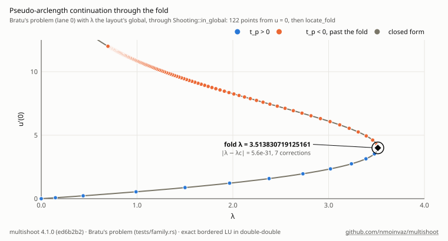

Every Newton solve takes multisolver's `NewtonOpts`, whose `scaling: Scaling::Iterates { floor }` measures each unknown
relative to its own size (NLEQ-ERR's scaled norms), for layouts whose node states and globals, such as a period or an
eigenvalue, differ by orders of magnitude.

## Installation

Add the crate from [crates.io](https://crates.io/crates/multishoot):

```sh
cargo add multishoot
```

or as a dependency in `Cargo.toml`:

```toml
[dependencies]
multishoot = "4.0"
```

It needs Rust 1.89 or later. It re-exports multidouble and multisolver, so it needs no other dependency. The feature
`portable` selects multidouble's plain-array backend on every target, and `mutate` adds the tests' deliberate errors.

## Usage

The example solves y'' = 3/2 y² on [0, 1] with y(0) = 4 / a² and y(1) = 4 / (1 + a)², whose solution is
y = 4 / (a + x)², for 8 values of a, one per lane, so the problem is pointwise. Newton's method starts in double-double
from the line between the end values, and a quad-double solve refines the root.

```rust
use multishoot::lane::{Lane, DV};
use multishoot::multidouble::dd::split;
use multishoot::multisolver::{prec::widen, NewtonOpts};
use multishoot::{cs, Double, Equations, Fl, Plan, Quad, Shooting, State, Work, DD};

/// y'' = 3/2 y^2 as y' = p, p' = 3/2 y^2, with y given at both ends
struct Model {
    y0: Fl<DV, 1>,
    y1: Fl<DV, 1>,
}

impl Equations<1> for Model {
    const NF: usize = 2; // y, p
    const NL: usize = 1; // p(0)
    const NR: usize = 1; // p(1)
    const POINTWISE: bool = true;
    type Prep = ();

    /// (k + 1) y_(k+1) = p_k, (k + 1) p_(k+1) = 3/2 (y y)_k
    fn taylor_coeffs<T: Lane>(&self, _x0: f64, _g: &[T], w: &mut Work<T, 1>) {
        for k in 0..w.kt {
            let ik = DD::ONE / DD::from_f64((k + 1) as f64);
            let yy = cs(&w.c[0], &w.c[0], k);
            w.c[0][k + 1] = w.c[1][k].muls(ik);
            w.c[1][k + 1] = yy.muls(DD::from_f64(1.5) * ik);
        }
    }

    fn left_state<T: Lane>(&self, _x: f64, data: &[Fl<T, 1>], _g: &[T], _prep: &()) -> State<T, 1> {
        vec![Fl::cst(&self.y0), data[0]]
    }

    fn right_state<T: Lane>(&self, _x: f64, data: &[Fl<T, 1>], _g: &[T], _prep: &()) -> State<T, 1> {
        vec![Fl::cst(&self.y1), data[0]]
    }
}

/// y = 4 / (a + x)^2 at x, a = 1 + j / 8 on lane j
fn exact(x: f64) -> Fl<DV, 1> {
    let v: Vec<DD> = (0..8)
        .map(|j| {
            let s = DD::from_f64(1.0 + j as f64 / 8.0 + x);
            DD::from_f64(4.0) / (s * s)
        })
        .collect();
    let (hi, lo) = split(&v);
    Fl::load(&hi, &lo)
}

fn main() {
    let model = Model {
        y0: exact(0.0),
        y1: exact(1.0),
    };
    let mut sh = Shooting::new(model, vec![0.0, 0.25, 0.5, 0.75, 1.0], 24);

    // z = [p(0) | y, p at each node | p(1)], 8 lanes each, as hi and lo parts; the start is the line between the ends
    let mut z = vec![vec![0.0; sh.len()]; 2];
    for j in 0..8 {
        let (y0, y1) = (sh.eq.y0.get(j).hi, sh.eq.y1.get(j).hi);
        z[0][j] = y1 - y0;
        for (i, &x) in sh.nodes.iter().enumerate() {
            z[0][sh.off_node(i) + j] = y0 + (y1 - y0) * x;
            z[0][sh.off_node(i) + 8 + j] = y1 - y0;
        }
        z[0][sh.off_right() + j] = y1 - y0;
    }
    let plan = Plan {
        kt: 24,
        tol: 1e-32,
        hmax: 0.25,
    };
    sh.plan_segments(&z[0], &z[1], &plan);

    let rep = sh.newton::<Double>(&mut z, &NewtonOpts::default()).unwrap();
    assert!(rep.converged);
    let err = (0..sh.k())
        .map(|i| {
            let o = sh.off_node(i);
            (Fl::<DV, 1>::load(&z[0][o..o + 8], &z[1][o..o + 8]) - exact(sh.nodes[i])).amax()
        })
        .fold(0.0, f64::max);
    let fnorm: Vec<String> = rep.fnorm.iter().map(|f| format!("{f:.1e}")).collect();
    println!("double-double: max |F| {}; max |y - y*| {err:.1e}", fnorm.join(", "));

    // the same problem in quad-double, from the double-double root
    let mut zq = widen(&z, 4);
    let opts = NewtonOpts {
        tol: 1e-60,
        ..Default::default()
    };
    let rep = sh.newton::<Quad>(&mut zq, &opts).unwrap();
    assert!(rep.converged);
    println!("quad-double: max |F| {:.1e}", rep.fnorm.last().unwrap());
}
```

It prints

```text
double-double: max |F| 5.6e0, 2.8e-1, 2.0e-3, 8.8e-8, 2.0e-16, 1.7e-31; max |y - y*| 3.7e-32
quad-double: max |F| 5.3e-64
```

The steps are planned once, from the start. The quad-double root is the discrete system's to quad-double rounding, but
the end values are double-double constants (`Fl::cst`), so it stays about 1e-32 from y*.

## Building and testing

```sh
cargo test --release                                            # SSE2 on x86-64, NEON on aarch64
cargo test --release --features portable                        # the plain-array backend
RUSTFLAGS="-C target-feature=+avx2,+fma" cargo test --release   # AVX2
cargo test --release --features mutate                          # the mutation controls
cargo fmt --check
cargo clippy --all-targets --features mutate -- -D warnings
cargo clippy --all-targets --features portable,mutate -- -D warnings
cargo llvm-cov --release --features mutate                      # coverage (cargo-llvm-cov)
```

The tests run in release mode, as the planted problems run Newton's method in quad-double and octo-double. A default
aarch64 build is the NEON backend. CI runs the suite on:

- SSE2, AVX2 and portable on x86-64 Linux, and the mutation controls;
- NEON on ARM64 Linux and macOS;
- MSVC on Windows x64.

It also runs coverage, rustfmt, clippy on three backends, the documentation, and a check at the minimum Rust version.

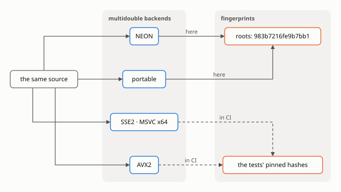

## References

1. R. E. Wengert, "A simple automatic derivative evaluation program", Commun. ACM 7(8), 463–464, 1964,
   [doi:10.1145/355586.364791](https://doi.org/10.1145/355586.364791). Forward-mode duals, the exact Jacobian and J v.
2. C. B. Moler, "Iterative refinement in floating point", J. ACM 14(2), 316–321, 1967,
   [doi:10.1145/321386.321394](https://doi.org/10.1145/321386.321394). The mixed-precision Newton step and the
   refined periodic solves of endpoint maps.
3. L. N. Trefethen, *Spectral Methods in MATLAB*, SIAM, Philadelphia, 2000, ch. 3,
   [doi:10.1137/1.9780898719598](https://doi.org/10.1137/1.9780898719598). The derivative matrix of the periodic grid.

## Related crates

- [multidouble](https://github.com/nmoinvaz/multidouble) is the double-, quad- and octo-double arithmetic this crate
  is written over, with the dual numbers that give its exact Jacobians.
- [multisolver](https://github.com/nmoinvaz/multisolver) holds the nonlinear solvers that this crate's layout is
  solved with, from Newton's method to the argument-principle zero count.

## License

BSD 3-Clause, see [LICENSE](LICENSE).
